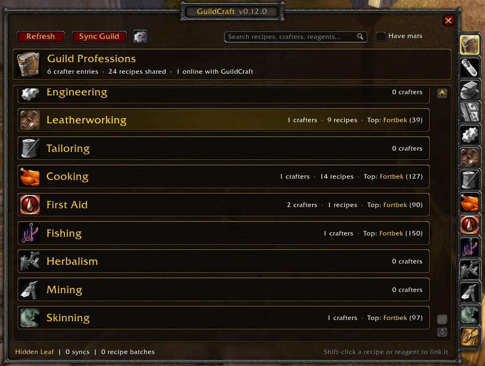
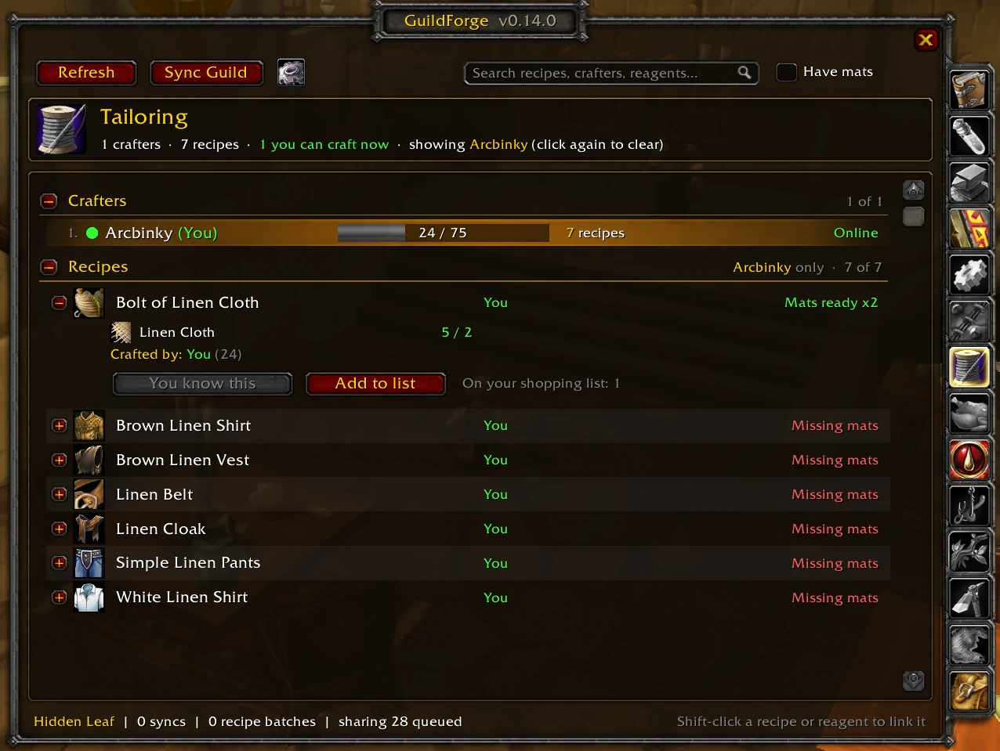
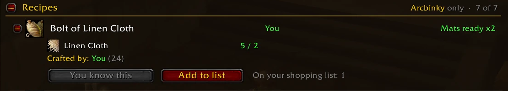
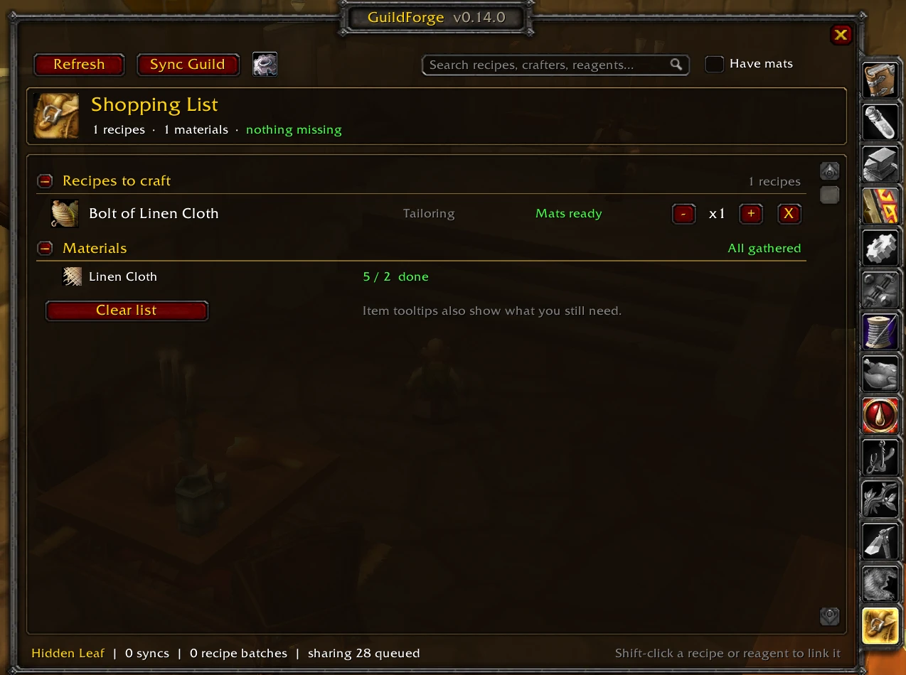
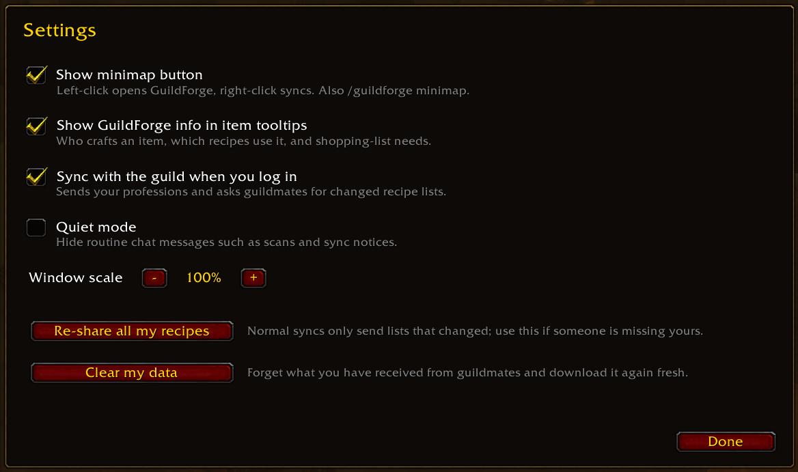

<!-- Paste everything below this line into the CurseForge project description (Markdown mode). -->

# GuildForge

**Stop asking "can anyone make this?" in guild chat.**

GuildForge turns your whole guild into one shared profession book. Every member's skills and known recipes sync quietly in the background, so you can see who can craft what, what it takes, and whether you already have the mats, in one click.

Built for **WoW Forever**. Also works on **Classic Era**.

## Your guild's crafting hub

The window opens on **Home**: guild news (who hit a skill milestone, learned a recipe first in the guild, or finished a request), who's online with GuildForge and their professions, requests you can make, and cooldowns that are ready.

## Request it, even when nobody's on

Expand a recipe and click **Request**, with an optional note. It goes on the guild's **Request Board**: guildmates who can make it see it (and get a heads-up in chat), **I'll make it** whispers you and marks it taken, and **Done** credits the crafter in guild news. Requests close after 3 days, and guildmates who log in later catch up.

## Find a crafter in seconds

Pick a profession from the tabs down the side and see everyone in the guild who has it, ranked by skill. A green dot means they're online right now; offline crafters show when they were last seen. Click a crafter to see just their recipes.

## Know exactly what it takes

Every recipe shows its icon, quality, who can make it, and whether **you** have the mats: `Mats ready x2` or `Missing mats`. Expand a recipe to see each reagent with your bag count (and what's sitting in your bank).

- **Ask a crafter:** one click whispers the best online crafter with the item link and the mats you already have.
- **Add to list:** queue it on your shopping list.
- **Shift-click** any recipe or reagent to link it in chat.

## Shop smarter

Add the things you want to make and GuildForge totals up every material you need, how much you've gathered, and what's still missing. The same "need 4 more" note shows on item tooltips everywhere: your bags, vendors and the auction house.

## Pull mats from the guild bank

If your guild uses [Guild Bank Toons](https://github.com/kota150/GuildBankToons), GuildForge works with it (without it, none of this shows):

- **Guild bank stock** next to your own counts on every reagent (`Guild bank: 120`).
- **Get mats from guild bank** asks the bank for whatever your bags are missing, for one recipe or your whole shopping list.
- **Craft order via guild bank** on a recipe you can't make: the bank mails the mats straight to the crafter, and GuildForge whispers them to make it for you.
- Requests wait for a bank officer's approval, and the buttons grey out when the bank has none of what you need.

## Your guild's crafters in Discord

An optional Discord bot ([setup on GitHub](https://github.com/TheFrosty02/GuildForge#discord-bot)) keeps a crafting leaderboard pinned in a channel and updates it in place, can post guild news to a channel, and adds `/levels`, `/crafts`, `/leaderboard` and `/requests` commands whose answers only the asker sees. One guildmate runs it on their PC; it's not part of the addon download.

## Also in the box

- **Item tooltips:** hover any item to see which guildmates craft it and which recipes use it.
- **Cooldowns:** Mooncloth, transmutes and the Salt Shaker are tracked and shared, so the guild knows who's ready.
- **Not known in guild:** recipes seen at trainers that nobody has learned yet, sorted by the skill they need. Everyone's trainer visits fill it in.
- **Search everything:** recipes, crafters, professions and reagents ("linen" finds everything that uses Linen Cloth), plus a **Have mats** filter.
- **Minimap button** with a badge showing how many guildmates are online with GuildForge.
- **Message log:** Settings → Message log shows everything GuildForge sends and receives, live, with a **Copy** button that gets it ready to paste into Discord or a bug report.
- **WoW Forever ready:** works with first and last names (and Forever's per-character realms), and holds its messages while the game blocks addon chat (like combat in instances).

## Getting started

1. Install GuildForge and log in.
2. Click the **GF** minimap button or type `/gf`.
3. Open each of your professions once, so GuildForge can share your recipes.
4. Visit your trainers to fill in **Not known in guild**.

Get your guildmates to install it too: the more people running GuildForge, the more complete your guild's book gets.

| Command | What it does |
| --- | --- |
| `/gf` | Open or close GuildForge |
| `/gf sync` | Ask the guild for anything that changed |
| `/gf settings` | Open the settings |
| `/gf requests` | Open the Request Board |
| `/gf who` | List guildmates online with GuildForge and their versions |
| `/gf clear` | Forget received data and download it fresh |
| `/gf log` | Open the message log |
| `/gf debug` | Show how names and messages are read, for bug reports |

`/guildforge` and `/gforge` work too.

## FAQ

**Will it spam guild chat?**
No. GuildForge uses hidden addon messages that never show up in chat. When you log in, each guildmate answers with one short summary, and only the data that actually changed gets sent. It's built to stay light even in large guilds.

**Does everyone in the guild need it?**
Only people who want to appear in the list or see it. Anyone without GuildForge simply isn't listed.

**What gets shared?**
Your profession skill levels, the recipes you know, your profession cooldowns and trainer recipes you've seen, with your own guild only. Nothing leaves the game.

**Does it work across my alts?**
Yes. Data is kept separately for each guild, so alts in different guilds never mix.

**Something looks wrong.**
Open Settings and click **Clear my data**. GuildForge forgets what it received and downloads everything fresh, keeping your own professions. If that doesn't fix it, open the **Message log**, click **Copy** and paste it into a GitHub issue.

## Feedback

Found a bug or have an idea? Open an issue on [GitHub](https://github.com/TheFrosty02/GuildForge/issues).
