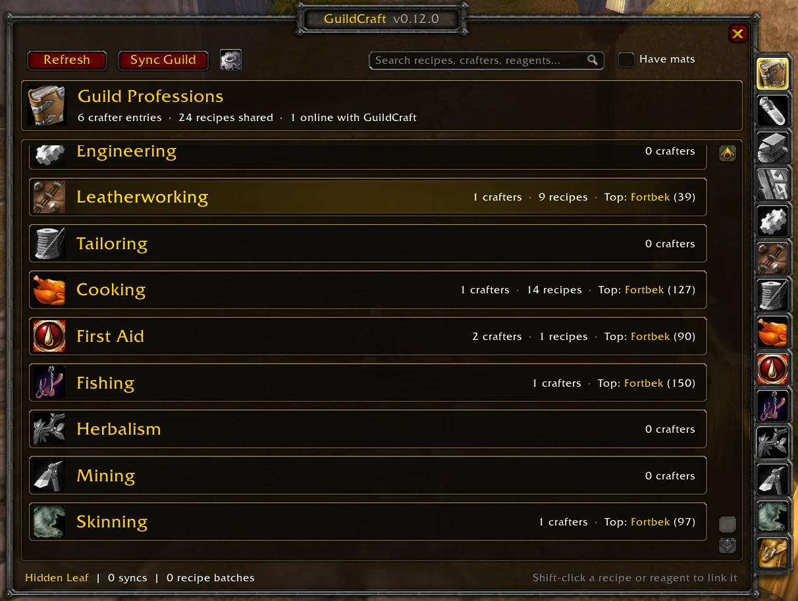
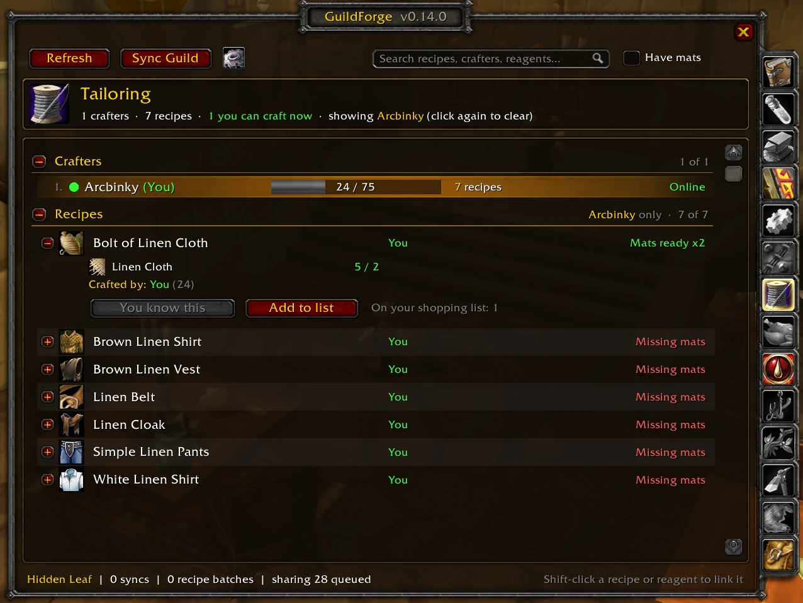
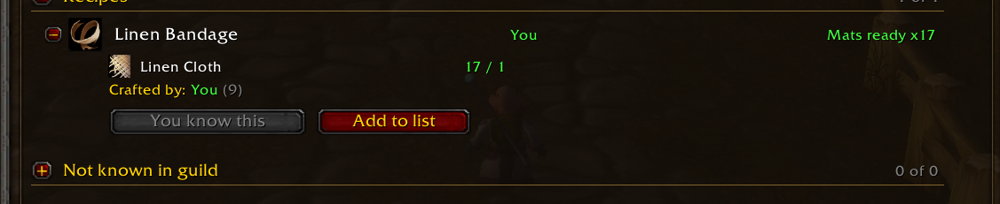
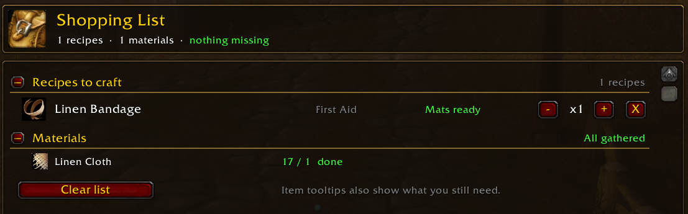
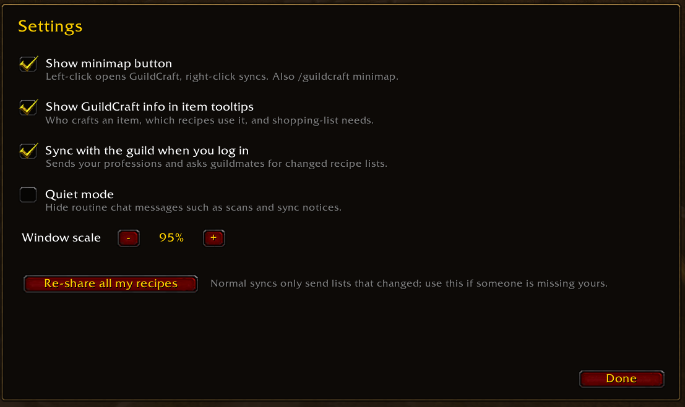

# GuildCraft

**Your guild's professions, all in one place.** GuildCraft shares every member's profession skills and known recipes over guild addon chat, so you can see who can craft what, what it takes to make it, and whether you already have the mats — without spamming guild chat.

Works on **WoW Classic Era** and is ready for **WoW: Forever**.

## Features

### Every profession at a glance
The **All** tab lists each profession with how many guildmates have it, how many recipes are shared, and the top crafter. Profession tabs run down the right side of the window, spellbook style, with their icons — professions nobody in the guild has yet are greyed out.

### Crafters, ranked and live
Open a profession to see every guildmate who has it, ranked by skill with a color-coded bar (Apprentice, Journeyman, Expert, Artisan). A green dot means they're online right now; offline crafters show when they were last seen. Click a crafter to show only their recipes.

### Recipes with reagents and your mat counts
Every known recipe shows its icon, item-quality color, who can craft it, and whether **you** have the mats in your bags (`Mats ready x17`, `Missing mats`). Expand a recipe to see each reagent with what you have against what's needed, plus anything sitting in your bank.

- **Ask a crafter** — one click whispers the best online crafter with the item link and the mats you already have.
- **Add to list** — queue it on your shopping list.
- **Shift-click** any recipe or reagent to link it in chat; hover for the full item tooltip.

### Shopping list
Collect the recipes you plan to make and GuildCraft combines them into one list of materials, showing what you've gathered and how many more you need. The same "need 4 more" note appears on item tooltips everywhere — bags, vendors and the auction house.

### And more
- **Search** recipes, crafters, professions and reagents (try "linen") across the whole guild, plus a **Have mats** filter for things you can craft right now.
- **Item tooltips** show which guildmates craft an item and which recipes use it.
- **Cooldowns** — Mooncloth, transmutes and the Salt Shaker are tracked and shared, so the guild can see who's ready.
- **Not known in guild** — recipes seen at trainers that nobody in the guild has learned yet, with the skill they require.
- **Minimap button** — a "GC" bubble with a badge counting guildmates online with GuildCraft. Left-click to open, right-click to sync, drag to move.
- **Light on guild chat** — syncs send a short fingerprint of each recipe list, and guildmates only download lists that changed.

### Settings
Click the gear next to **Sync Guild** to toggle the minimap button, item tooltips, syncing on login and quiet mode, adjust the window scale, or re-share all of your recipes.

## Installation

1. Download this repository and put the `GuildCraft` folder in your AddOns folder:
   - Classic Era: `World of Warcraft/_classic_era_/Interface/AddOns/GuildCraft`
2. Make sure the folder contains `GuildCraft.toc` and `GuildCraft.lua`.
3. Restart the game (or `/reload`) and enable GuildCraft on the character select AddOns screen.

## Getting started

1. Open each of your professions once (for example your First Aid or Leatherworking window). GuildCraft scans the recipes you know and shares them with the guild.
2. Visit profession trainers to fill in the **Not known in guild** lists.
3. Click the **GC** minimap button or type `/guildcraft` to open the window.

Your guildmates need GuildCraft too — the more people running it, the more complete the guild's list gets.

## Slash commands

| Command | What it does |
| --- | --- |
| `/guildcraft` | Open or close the window (also `/gcraft`, `/guildprof`) |
| `/guildcraft sync` | Ask the guild for any changed professions and recipes |
| `/guildcraft push` | Re-share all of your recipes in full |
| `/guildcraft refresh` | Rescan your own professions |
| `/guildcraft settings` | Open the settings panel |
| `/guildcraft minimap` | Show or hide the minimap button |
| `/guildcraft status` | Print sync counters |

## Compatibility

- **Classic Era** (interface 11509) is the main target.
- **WoW: Forever** (interface 16001, from the beta) is supported from the same files and also appears in the minimap addon menu. Forever's API may still change before and after launch.
- Guildmates on older GuildCraft versions still sync with newer ones; they just won't see reagent details, cooldowns or the faster summary syncing until they update.

## Credits

Created by TheFrosty02, with UI and feature work by kota150.
